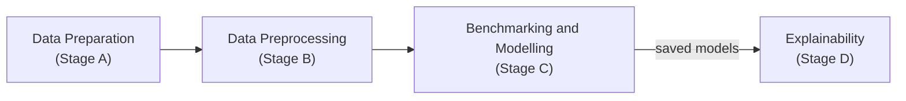

# Toolkits

Each toolkit groups the tools of one stage of a longitudinal analysis. They chain as follows, although each one can also be used on its own, since every tool reads and writes files on disk (CSV for most tools, with dedicated converters for Parquet and Stata).

  <a class="toolkit-card" href="data-preparation/">
    Stage A
    Data Preparation
    Generation of synthetic longitudinal cohorts with known trends, shocks or missingness, and conversion of files between CSV, Parquet and Stata.
    <code>TrendPatterns</code><code>MissingDataScenarios</code><code>StataToCsv</code>
  </a>
  <a class="toolkit-card" href="data-preprocessing/">
    Stage B
    Data Preprocessing
    Cleaning, imputation, category harmonisation, and long to wide (or cross-sectional) reshaping of repeated measures.
    <code>CleanDataset</code><code>MissingImputation</code><code>PivotLongToWide</code>
  </a>
  <a class="toolkit-card toolkit-card--wide toolkit-card--main" href="benchmarking-and-modelling/">
    

      Stage C · Main toolkit
      Benchmarking and Modelling
      Ranks standard and longitudinal estimators all against all, under one shared protocol, so that the value of machine learning over the statistical analysis in place is measured on the data at hand; then trains one chosen estimator in depth.
      <code>BenchStandardAndLongitudinalML</code><code>BenchmarkStandardML</code><code>BenchmarkLongitudinalML</code><code>StandardMachineLearning</code><code>LongitudinalMachineLearning</code>
    

    

      
<em>benchmark_report.txt</em>

      <pre>1. Logistic Regression                    0.796
2. MerWavTimePlus + Lexico Random Forest  0.779
3. Random Forest                          0.759
4. SepWav (Voting) + Random Forest        0.722
5. AggrFunc (Mean) + Logistic Regression  0.605</pre>
    

  </a>
  <a class="toolkit-card toolkit-card--wide" href="explainability/">
    

      Stage D
      Explainability
      Explains the predictions of a saved model, e.g., the best estimator of a benchmark, with SHAP values: which features, and which waves, drive them.
      <code>SHAPAnalysis</code>
    

    

      
<em>shap_analysis_report.txt</em>

      <pre>Top features by mean absolute SHAP value
1. mood_score_w3: 0.165802
2. mood_score_w2: 0.076778
3. sleep_score_w3: 0.042331
4. mood_score_w1: 0.040893</pre>
    

  </a>

## Proposing a New Toolkit or Tool

A new tool (e.g., an imputer, an estimator or a file converter) usually fits an existing toolkit, whereas a new toolkit is warranted when a whole stage of longitudinal analysis is missing. Either way, the starting point is a feature request on GitHub.

[:material-github: Request a data preparation tool](https://github.com/Long-Toolkit/long-toolkit/issues/new?template=feature_data_preparation.yml){ .md-button }
[:material-github: Request a preprocessing tool](https://github.com/Long-Toolkit/long-toolkit/issues/new?template=feature_data_preprocessing.yml){ .md-button }
[:material-github: Request a benchmarking or modelling tool](https://github.com/Long-Toolkit/long-toolkit/issues/new?template=feature_machine_learning.yml){ .md-button }
[:material-github: Request an explainability tool](https://github.com/Long-Toolkit/long-toolkit/issues/new?template=feature_explainability.yml){ .md-button }

